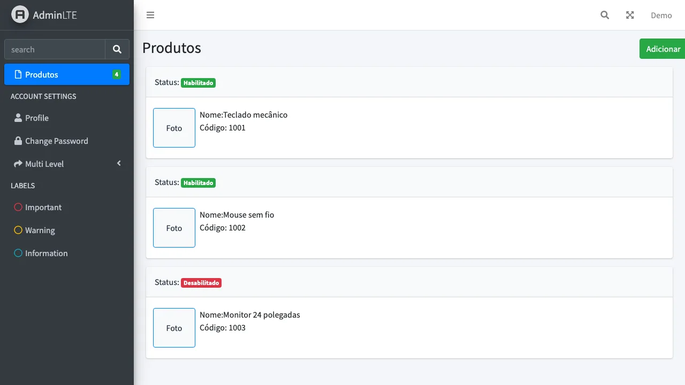
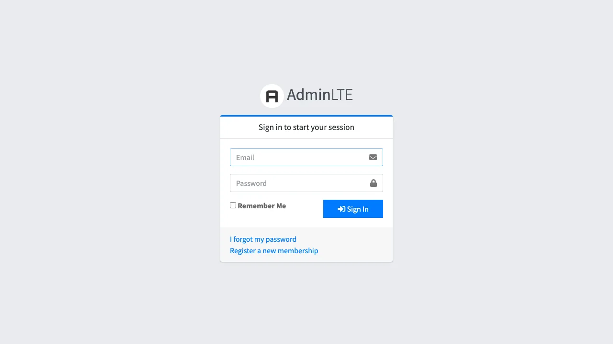
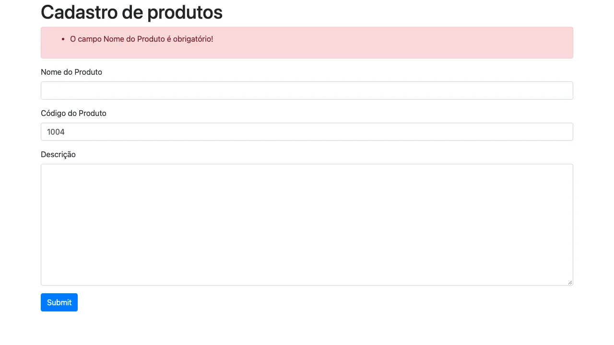
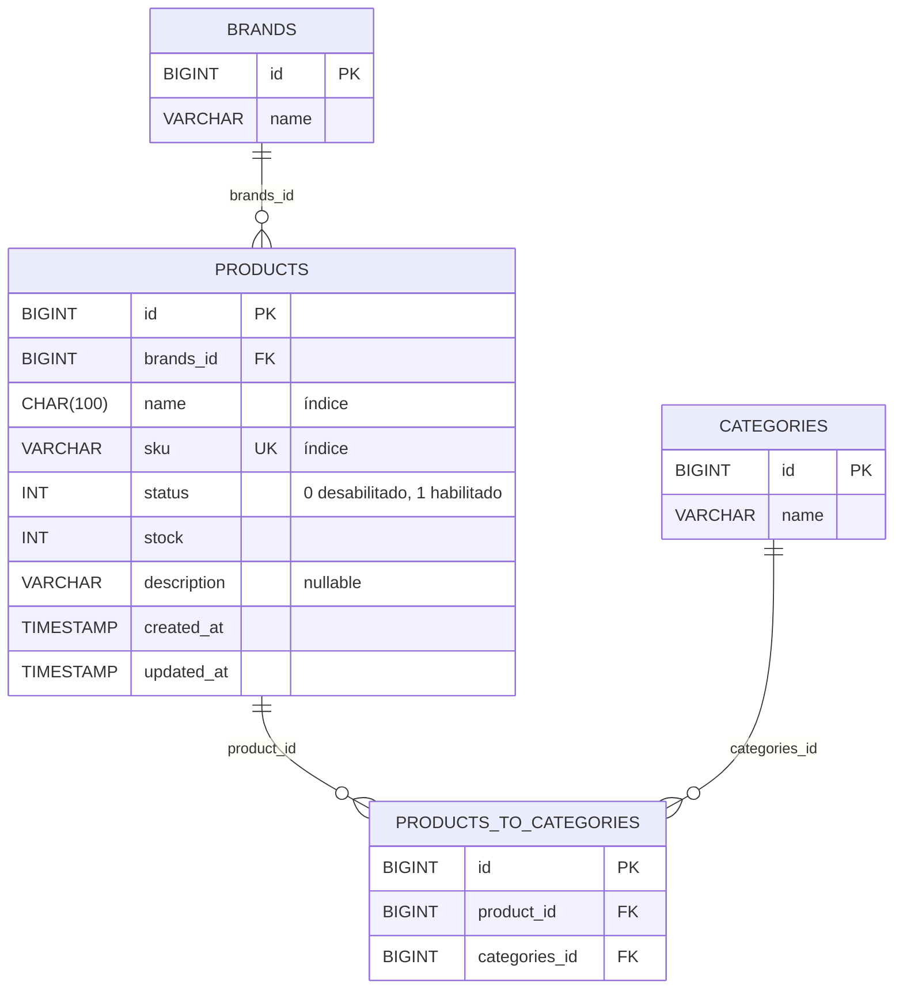

# Curso Laravel: painel de produtos

Projeto de estudo de Laravel 12 feito acompanhando um curso de Laravel ("API e aplicações web escaláveis com Docker, do zero ao deploy"). Cada commit é uma aula: rotas, controllers, migrations, relacionamentos, Eloquent, joins, Blade, componentes, AdminLTE, autenticação e middleware `auth`.



| Login (laravel/ui + AdminLTE) | Cadastro de produto com erro de validação |
|---|---|
|  |  |

Prints do projeto rodando localmente com SQLite e dados fictícios. O segundo mostra um bug real: o formulário envia `name`, mas a validação espera `product_name` (ver "Limitações conhecidas").

## O que o projeto cobre

| Tema | Onde |
|---|---|
| Rotas nomeadas, grupos com prefixo `/admin` e middleware `auth` | `routes/web.php` |
| Controller de recurso (index, create, store, show, edit, update, destroy) | `app/Http/Controllers/ProductsController.php` |
| Form Request com mensagens próprias | `app/Http/Requests/StoreOrUpdateRequest.php` |
| Migrations: criar, alterar coluna (`change()`), índices, chave estrangeira, tabela pivô | `database/migrations/2025_06_05_*` |
| Model Eloquent com `$fillable` | `app/Models/Products.php` |
| Joins (left, right, inner), deixados comentados no `index()` | `ProductsController::index` |
| Blade com `@extends`, `@section` e componentes (`<x-product-list>`, `<x-status-badge>`) | `resources/views/products/`, `app/View/Components/` |
| Template AdminLTE (`jeroennoten/laravel-adminlte`) com menu "Produtos" | `config/adminlte.php`, `public/vendor/` |
| Autenticação: login e cadastro do `laravel/ui` (`Auth::routes()`); o Breeze também foi instalado | `app/Http/Controllers/Auth/`, `routes/auth.php` |

## Modelo de dados



Além dessas, as migrations padrão criam `users`, `password_reset_tokens`, `sessions`, `cache` e `jobs`.

## Rotas

Todas as rotas de produtos exigem login e respondem HTML. Não há `routes/api.php`, então não existe API JSON para documentar em OpenAPI.

| Método | URL | Nome | O que faz |
|---|---|---|---|
| GET | `/admin/produtos` | `products.index` | Lista os produtos |
| GET | `/admin/cadastrar-produto` | `products.create` | Formulário de cadastro |
| POST | `/admin/salvar-produto` | `products.store` | Valida e grava |
| GET | `/admin/produto/{id}` | `products.show` | Mostra um produto (de um array fixo, ver limitações) |
| GET | `/admin/editar-produto/{id}` | `products.edit` | Formulário de edição |
| POST | `/admin/atualizar-produto/{id}` | `products.update` | Atualiza nome e descrição |
| GET | `/admin/excluir-produto/{id}` | `products.destroy` | Exclui |
| GET | `/login`, `/register`, `/password/reset`... | `Auth::routes()` | Autenticação do `laravel/ui` |
| GET | `/home` | `home` | Painel depois do login (precisa do build do Vite) |
| GET | `/` | | Página de boas-vindas do Laravel |

## Stack

PHP 8.2+, Laravel 12, `laravel/ui` + Breeze, AdminLTE 3, Bootstrap, Vite + Sass, SQLite por padrão (MySQL, Redis, Meilisearch, Mailpit e Selenium no `docker-compose.yml` do Sail).

## Como rodar

### Local, com SQLite (o que foi usado nos prints)

Pré-requisitos: PHP 8.2+ com `pdo_sqlite`, Composer e Node.

```bash
composer install
cp .env.example .env          # DB_CONNECTION=sqlite por padrão
php artisan key:generate
touch database/database.sqlite
php artisan migrate
npm install && npm run build  # a /home usa @vite; sem o build ela dá erro 500
php artisan serve             # http://localhost:8000/login
```

Crie um usuário em `/register`. A lista de produtos começa vazia e o cadastro pela tela não grava (ver limitações); para ver a lista preenchida, insira uma marca e alguns produtos pelo `php artisan tinker`.

### Com Docker (Laravel Sail)

O `docker-compose.yml` é o do Sail e usa a imagem de `vendor/laravel/sail`, então o `composer install` vem antes. No `.env`, troque para MySQL (`DB_CONNECTION=mysql`, `DB_HOST=mysql`, `DB_DATABASE`, `DB_USERNAME`, `DB_PASSWORD`) e então:

```bash
./vendor/bin/sail up -d
./vendor/bin/sail artisan migrate
```

O caminho com Sail não foi testado nesta revisão.

## Estrutura

```text
app/Http/Controllers/    ProductsController, HomeController, Auth/ (ui + Breeze)
app/Http/Requests/       StoreOrUpdateRequest
app/Models/              Products, User
app/View/Components/     ProductList, StatusBadge
database/migrations/     produtos, marcas, categorias, pivô
resources/views/         products/, components/, auth/, layouts/
routes/web.php           rotas do app
config/adminlte.php      menu e layout do AdminLTE
```

## Testes

```bash
DB_DATABASE=:memory: php artisan test
```

O `phpunit.xml` aponta para um banco `testing` (pensado para o MySQL do Sail); com SQLite em memória a suíte roda. Resultado em 24/11/2026: 6 de 25 testes passam e 19 falham. As falhas são dos testes do Breeze: o `bootstrap/app.php` não carrega o `routes/auth.php` (as rotas ativas são as do `laravel/ui`), então rotas como `password.confirm` e `verification.notice` não existem.

## Limitações conhecidas

Encontradas rodando o projeto; o código não foi alterado.

- **O cadastro de produto nunca passa da validação.** `StoreOrUpdateRequest` exige `product_name`, mas o campo do formulário se chama `name`. A descrição é enviada como `product_description` e o controller lê `description`.
- **`store()` e `update()` terminam em `dd()`**, então mesmo com a validação corrigida a tela para no dump, sem redirecionar.
- **`show()` não consulta o banco**: usa um array fixo com 3 produtos de exemplo, e um id fora de 0 a 2 gera erro de índice.
- **Exclusão por GET**, sem confirmação (`/admin/excluir-produto/{id}`).
- **`/hello` dá erro 500**: a view `hello-world` não existe.
- **`products.index`**: o botão "Adicionar" não tem link.
- **Migrations**: `->rrequired()` (erro de digitação, ignorado em silêncio) e `->nullable` sem parênteses em `stock` (a coluna não fica nullable). A chave `brands_id` é obrigatória e sem valor padrão, então a migration falha se a tabela `products` já tiver linhas.
- Com PHP 8.5, o `config/database.php` gera avisos de depreciação de `PDO::MYSQL_ATTR_SSL_CA` (sem efeito com PHP 8.2 a 8.4).
